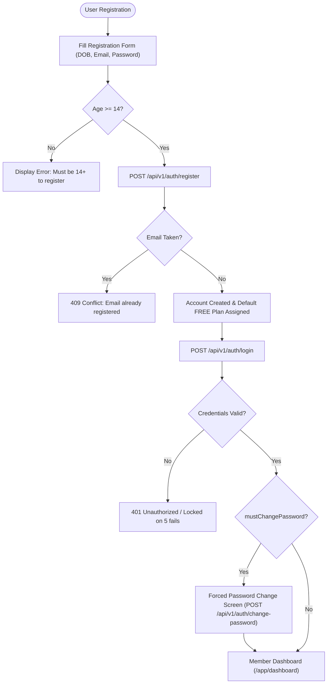
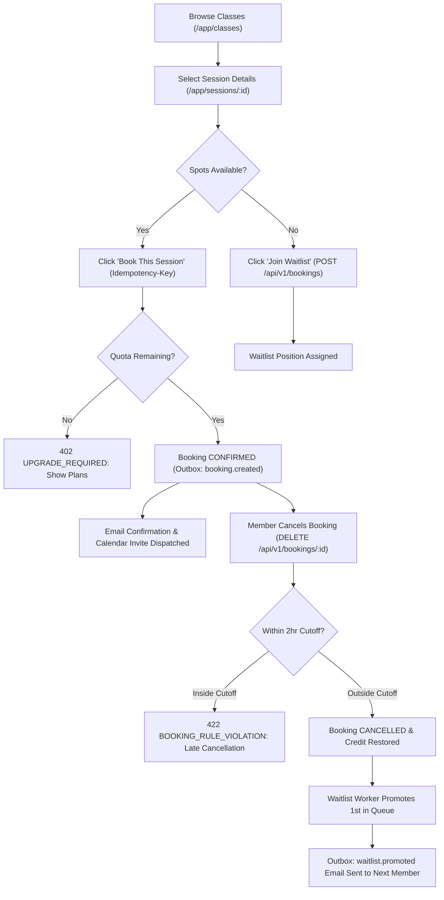
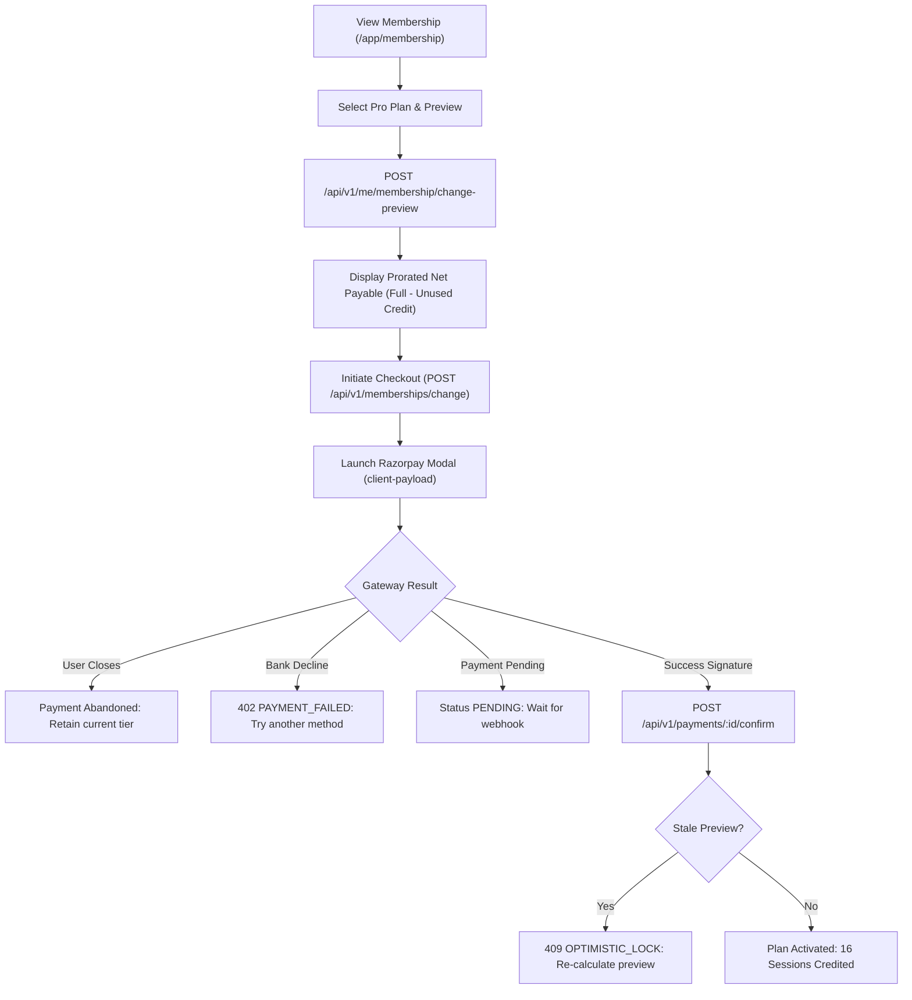
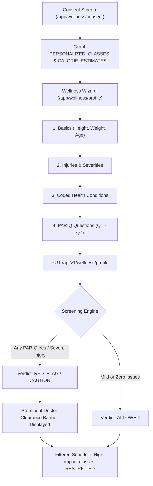
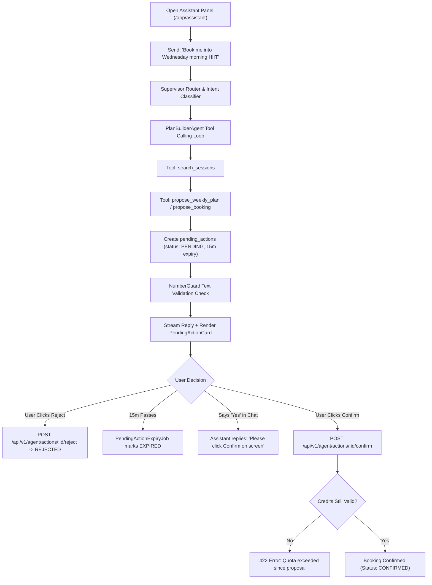
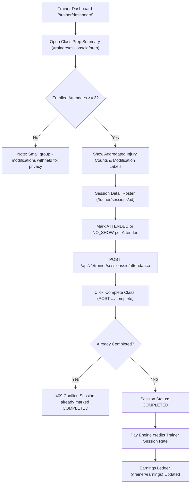
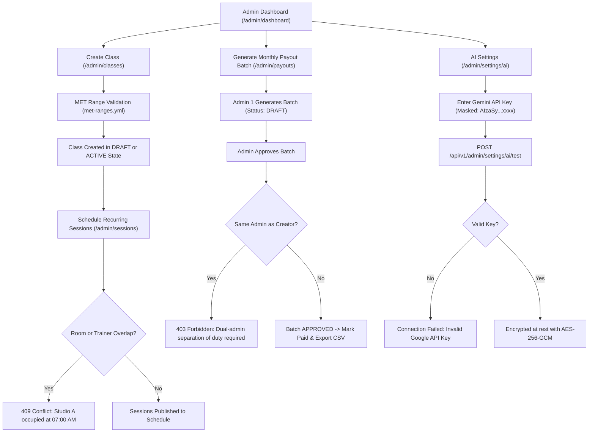

# FitFlow Core User Flows (docs/design/flows.md)

This document diagrams the primary end-to-end user journeys in FitFlow across Member, Trainer, and Administrator roles. Each flow outlines the complete happy path alongside at least three documented failure/exception branches.

---

## Flow 1: Registration, First Login & Forced Password Change

### 1.1 Diagram

### 1.2 Path Specifications
- **Happy Path**: User enters valid details with DOB $\ge 14$ years. Registration completes; default FREE plan with 3 session credits is assigned. On first sign-in, if `mustChangePassword` is false, user is routed directly to `/app/dashboard`. If created by an admin with a temporary password (`mustChangePassword: true`), user is gated to set a new password first, then lands on Home.
- **Failure Path 1 (Underage)**: User enters DOB indicating age $<14$. Form fails with 400 Bad Request: *"You must be at least 14 years old to join FitFlow."*
- **Failure Path 2 (Duplicate Email)**: User registers an email that already exists. Backend returns 409 Conflict with code `CONFLICT`.
- **Failure Path 3 (Account Lockout)**: User attempts sign-in with wrong password 5 consecutive times. Account is locked for 15 minutes returning 429 Too Many Requests with code `LOCKED` and a `Retry-After` header.

---

## Flow 2: Browse, Book, Confirmation, Cancellation & Waitlist Promotion

### 2.1 Diagram

### 2.2 Path Specifications
- **Happy Path**: Member finds open yoga session, clicks Book. 1 session credit is consumed from active plan. Outbox triggers confirmation email. User attends or cancels $>2$ hours prior to start; seat is released and credit is returned.
- **Failure Path 1 (Quota Exceeded)**: Member on FREE or Basic tier with 0 sessions remaining clicks Book. System rejects with 402 `UPGRADE_REQUIRED` and displays plan upgrade cards.
- **Failure Path 2 (Late Cancellation)**: Member attempts cancellation 45 minutes prior to class start ($< 2$ hours). System blocks cancellation with 422 `BOOKING_RULE_VIOLATION` explaining the 2-hour cutoff.
- **Failure Path 3 (Concurrent Seat Race)**: Two members click the last remaining seat simultaneously. One wins; the second receives 409 `SESSION_FULL` and is immediately offered waitlist enrollment.

---

## Flow 3: Membership Upgrade with Razorpay Checkout

### 3.1 Diagram

### 3.2 Path Specifications
- **Happy Path**: Member upgrades from Basic (Rs 499) to Pro (Rs 899). System calculates prorated credit of unused Basic days/sessions, netting Rs 750. User completes Razorpay checkout; signature is confirmed; Pro plan quota (16 sessions) is granted instantly.
- **Failure Path 1 (Card Declined)**: Bank declines charge. Razorpay reports error. Frontend catches event, keeps checkout open, and displays: *"Payment failed: Card declined by issuing bank. Please try another card."*
- **Failure Path 2 (User Abandons Modal)**: User closes payment modal without completing transaction. Checkout state resets; existing plan remains unchanged.
- **Failure Path 3 (Stale Preview Conflict)**: Member waited 25 minutes before completing payment, during which another transaction or billing cycle updated the membership. Confirmation detects version mismatch (`OPTIMISTIC_LOCK`) and prompts the user to review the updated total.

---

## Flow 4: DPDP Consent, Wellness Wizard, Safety Screening & Red-Flag Handling

### 4.1 Diagram

### 4.2 Path Specifications
- **Happy Path**: Member reviews plain-language DPDP consent text, accepts purposes. Member completes wizard steps with zero injuries or heart conditions. System evaluates verdict as `ALLOWED`. All classes are unlocked with metabolic burn guidance.
- **Failure Path 1 (Consent Revoked / Missing)**: Member attempts to access `/app/wellness/profile` without active consent. API returns 428 `CONSENT_REQUIRED` and redirects to the consent screen.
- **Failure Path 2 (PAR-Q Positive / RED_FLAG)**: Member answers "Yes" to Q1 (heart condition advised by doctor). Evaluation yields `RED_FLAG` with `doctorCheckRecommended: true`. High-intensity and HIIT classes are locked (`RESTRICTED`), and a doctor check banner is permanently pinned.
- **Failure Path 3 (Underage Access Attempt)**: Member aged 16 attempts to access nutrition/calorie numbers. Endpoint returns 400 `AGE_RESTRICTED`, explaining that metabolic wellness calculations require age $\ge 18$.

---

## Flow 5: Conversational AI Assistant Booking Proposal & Confirmation

### 5.1 Diagram

### 5.2 Path Specifications
- **Happy Path**: Member asks assistant for class recommendation. Agent finds open slot, calls `propose_booking`. System renders `PendingActionCard` with 15-minute countdown. Member clicks "Confirm". Backend verifies quota and executes booking; chat displays confirmation receipt.
- **Failure Path 1 (Chat Text Confirmation Refusal)**: User replies in chat: *"Yes, please book it."* Assistant prompt and guardrails forbid text-based writes; assistant replies: *"I have staged this for you, but for your security, please click the on-screen Confirm button."*
- **Failure Path 2 (Proposal Expiry)**: Member receives proposal card but gets distracted for 20 minutes. Background expiry job marks record `EXPIRED`. Clicking Confirm returns 422 `Unprocessable`: *"This action proposal has expired. Please ask again."*
- **Failure Path 3 (AI Unconfigured Fallback)**: Administrator has not configured Gemini key. Assistant panel displays yellow status notice: *"Demonstration mode"*. Tool suggestions fall back strictly to deterministic rule-based results.

---

## Flow 6: Trainer Session Attendance, Completion & Earnings Ledger

### 6.1 Diagram

### 6.2 Path Specifications
- **Happy Path**: Trainer opens prep summary, views aggregated knee/back modifications (identities withheld). After teaching, marks attendee roster and clicks "Complete Class". Backend transitions session to `COMPLETED` and queues session pay (e.g. Rs 500) into pending payout balance.
- **Failure Path 1 (Small Group Privacy)**: Class has only 2 enrolled attendees. Prep summary suppresses individual injury tags with the notice: *"Attendee count is below the privacy threshold. Anonymous modification counts are withheld to protect member confidentiality."*
- **Failure Path 2 (Premature Completion)**: Trainer attempts to mark session complete 2 hours before the class is scheduled to begin. System blocks action with 422: *"Sessions cannot be marked complete prior to their scheduled start time."*
- **Failure Path 3 (Duplicate Completion Call)**: Network glitch causes duplicate complete requests. Backend handles idempotently via status check, returning existing completion status without double-crediting payout.

---

## Flow 7: Administrator Class Creation, Dual-Admin Payout & Key Management

### 7.1 Diagram

### 7.2 Path Specifications
- **Happy Path**: Admin creates "Cardio Kickboxing", sets MET value 7.5 (valid per category rules). Schedules recurring Tuesday sessions; conflict engine confirms Studio B is clear. At month end, Admin 1 generates payout batch; Admin 2 reviews and approves batch. Banking CSV is exported.
- **Failure Path 1 (Room Conflict)**: Admin attempts to schedule session in Studio A during an existing Yoga class. Backend detects time overlap and returns 409 `CONFLICT`: *"Studio A is already reserved by Power Vinyasa from 07:00 to 08:00 AM."*
- **Failure Path 2 (Self-Approval of Payouts)**: Admin 1 creates a payout batch and attempts to click "Approve". Backend enforces separation of duties: 403 `FORBIDDEN` (*"A different administrator must approve payout batches."*).
- **Failure Path 3 (Invalid AI Key Test)**: Admin enters an invalid or revoked Gemini key. Connection test returns 400 Bad Request with details masked from client logs; key is not saved.
